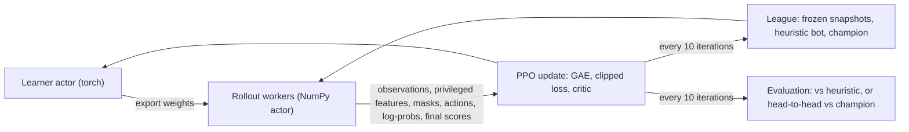

# How Shark was built and trained

Shark is the strongest bot in IB-Flip. It is a small neural network trained by
self-play with PPO, and it runs on the server in plain NumPy. This report covers
what the network sees, how it was trained, how its strength was measured, what
was tried and dropped, and where the work stopped. Every number here comes from
the code, the docs in this repository, or commit messages. Where something was
not recorded, the report says so.

Status: the shipped model is the round-3 champion from 1 November 2026. A
retrained "v3" candidate was tested in November and not promoted. Bot work was
closed for production on 14 November 2026.

## Contents

1. [The game, and why it is hard for an AI](#1-the-game-and-why-it-is-hard-for-an-ai)
2. [Architecture](#2-architecture)
3. [Training](#3-training)
4. [The training rounds](#4-the-training-rounds)
5. [What didn't work or wasn't shipped](#5-what-didnt-work-or-wasnt-shipped)
6. [How strength was measured](#6-how-strength-was-measured)
7. [Current status and how to reproduce](#7-current-status-and-how-to-reproduce)
8. [Lessons and future work](#8-lessons-and-future-work)

## 1. The game, and why it is hard for an AI

IB-Flip is a shedding game for 2 to 5 players. Each player gets three face-down
cards, three face-up cards on top of them, and a three-card hand. Before play,
everyone "fixes": they swap hand cards with their face-up cards and can stack
matching ranks. Players then take turns putting one or more cards of the same
rank on the live pile, drawing back to three while the deck lasts. When the hand
is empty they play their face-up cards, then their face-down cards blind. Ranks
have powers. A 10, or four of a kind in a row, flips the pile away and the
flipper goes again. 4s start chains, 9s force a draw from the discard, and
flipping four 8s loses on the spot. Finishing in a way that would give you
another turn (ending on a 2 or a 10, for example) is an illegal finish and
also loses. Full rules are in `IB-Flip__The_Complete_Rules.pdf`.

Several things make this hard for an AI:

- **Imperfect information.** You can't see the deck order, the face-down cards
  (including your own), or most of what opponents hold. You can see cards that
  went into an opponent's hand publicly, for example when they picked up the
  pile.
- **2 to 5 players with one policy.** The same network has to play heads-up and
  five-handed, and the right play differs a lot between them.
- **Long games.** A Shark-vs-Shark 2-player game averages about 370 decisions on
  the current rules (`docs/shark-training-v3.md`). The reward only arrives at the
  end.
- **Stalling loops.** Some positions let two players bounce cards back and forth
  forever. Both self-play training and live play needed explicit defences.
- **Placement scoring.** Under the current rules a game runs until every player
  has a place, so 2nd versus 3rd matters too, not just who wins.

The rules also changed under the model. Shark was trained on an earlier rule
set in which the first player to finish ended the game. The rulings of
1 November 2026 (commit 4cef915) and the audit of 7 November
(`docs/rules-audit.md`) changed drawing, slot stacking, pickup and placement.
That is why Shark was measured again on the current rules (section 7).

## 2. Architecture

### What the network sees

The observation encoder is `src/ibflip/ai/observation.py`. The shipped model
reads 299 numbers:

| Block | Size | Contents |
|---|---|---|
| Self | 31 | My hand and my face-up cards as counts per rank, hand size, number of face-down cards, which source I'm playing from |
| Live pile | 43 | Top rank, the rank to beat (or "anything"), ace-as-one flag, length of the same-rank run on top, rank counts in the pile, pile size |
| Piles | 28 | Discard counts per rank, discard and draw pile sizes, and how many of each rank are still unseen by me (card counting) |
| Opponents | 4 x 30 | For each opponent in turn order: still playing, hand size, cards publicly known to be in their hand, size of the unknown part of their hand, their face-up cards, number of face-down cards |
| Flags | 25 | 4-chain pending, open play group and its rank, cards played this turn, required starting card, game phase, table size, direction |
| v2 "lacks" | 4 x 13 | Per opponent, ranks they are publicly known not to hold (see below) |

The first 247 features are observation v1. Version 2 (commit 9892faa) added the
52 "lacks" features. When a player is forced to pick up or flip the deck,
everyone learns they had nothing playable on that target. The engine tracks
those ranks per player and clears them when the player draws unseen cards.
Features are only ever appended, so older models keep reading the same prefix.
The trainer widened old checkpoints with zero weights for the new inputs,
which leaves their behaviour unchanged.

Deliberately excluded: the draw pile order, every face-down card (your own
included), and the part of an opponent's hand nobody saw go in. Suits are
excluded too, because they never matter for play. A test,
`test_policy_observation_does_not_depend_on_hidden_card_assignment` in
`tests/test_audit_invariants.py`, shuffles the hidden cards and checks that the
observation doesn't change.

Version 3 (commit fdb3707) appends per-slot face-up information for every
player, placements, finished flags, turn distance and the range of places still
unclaimed, for 545 features in total. Only the unshipped v3 candidate uses it.

### Actions: 17 rank-level moves with a legal mask

Suits don't matter, so the network chooses ranks, not specific cards:

| Index | Meaning |
|---|---|
| 0 to 12 | Play a card of rank r (3, 4, ..., A, 2) |
| 13 | Pick up the live pile |
| 14 | Reveal the top of the draw pile |
| 15 | End the current play group |
| 16 | Flip a face-down card (your own are indistinguishable to you) |

`compact_legal` maps every legal engine action onto these 17 slots and returns a
mask. Illegal logits are set to -1e9 before the argmax or softmax, so the network
can only ever pick a legal move. When several concrete cards share a compact
action, one is chosen at random. Forced moves (the 9 draw) are applied without
asking the network, and so are decisions with only one legal option.

The v3 layout adds three "play face-up slot k" actions (20 in total), because
the current rules make the choice of slot matter. The shipped 17-action model
plays the current engine through an adapter in `MLPPolicy.logits`, which gives
each visible slot the logit of that slot's rank.

### The network

```
  299 legal-information features
              |
     Linear 299 -> 512, ReLU
     Linear 512 -> 512, ReLU
     Linear 512 -> 256, ReLU
     Linear 256 -> 17   (policy logits)
              |
   legal mask: illegal logits set to -1e9
              |
   safety veto: demote a move that loses on the spot
              |
   argmax (or temperature 1.5 if the repetition guard fires)
              |
   pick one concrete card of the chosen rank
```

The shipped `src/ibflip/ai/model.npz` contains 551,953 weights in float16
(arrays `w0` 299x512, `w1` 512x512, `w2` 512x256, `pw` 256x17 and biases). The
file is 1,012,656 bytes. It predates the provenance metadata that later exports
embed.

### Asymmetric critic (training only)

PPO needs a value estimate. In `scripts/train_ppo.py` the critic is a separate
network with the same hidden sizes. It takes the 299 actor features plus 130
privileged ones: my own face-down cards, the draw pile contents, and each
opponent's full hand and face-down cards, as counts per rank. Seeing the hidden
cards gives a much less noisy value estimate in an imperfect-information game.
That's acceptable because the critic is thrown away after training. Only the
actor is exported, so the deployed bot never sees hidden cards.

### NumPy-only runtime

At runtime `MLPPolicy` (`src/ibflip/ai/agents.py`) does the forward pass with
four NumPy matrix multiplies (three hidden layers and the policy head). Torch is only a training dependency. The November
validation measured one `NeuralAgent.choose` call at 0.24 to 0.28 ms per move on
one CPU process, including encoding and the safety check. A bare forward pass
took 0.12 to 0.13 ms for the shipped model (0.08 to 0.09 ms for the v3
candidate, which skips the legacy adapter).

### Hand-written safety layers around the network

`NeuralAgent` wraps the policy with three pieces of plain code:

- **Safety veto.** Before taking the top-ranked move, `loses_immediately`
  simulates it on a copy of the engine. If the move finishes illegally or flips
  the 8s, its logit drops to -1e8 and the next-best move is checked. The check
  uses only information the mover has, so moves with a hidden outcome (flipping
  a face-down card, revealing the deck) are never flagged.
- **Repetition guard.** `RepetitionGuard` counts how often the same position
  (my hand, the top of the pile, hand sizes) recurs. It also counts how many of
  the bot's own turns pass with no change to the deck, discard pile or table
  cards. If a position has come up more than twice, or nothing has changed for
  12 turns, the agent samples at temperature 1.5 instead of playing greedily.
  This came from real loops, for example two bots bouncing 4s between them
  (commits 92da557 and cd469b1).
- **Hand fixing is not learned.** `heuristic_fix` puts high-value ranks face up
  (10, 2, 4 and 5 rank highest in `KEEP_VALUE`), then stacks matching visible
  and hand cards. Training and live play use the same function.

Training does not use the safety veto or the repetition guard. The learner
samples straight from its masked policy, and evaluation uses the full runtime
agent.

## 3. Training

### The PPO self-play loop



Each iteration, worker processes play whole games until they have collected a
fixed number of learner decisions (65,536 by default). Each game picks a table
size at random from `--player-counts`. Workers use the same NumPy forward pass
that ships, with one BLAS thread each. The next batch of rollouts runs while
the learner updates on the current one, so the data is one iteration stale.
PPO's importance ratio, computed from the stored log-probabilities, accounts
for that.

Defaults in `scripts/train_ppo.py` (unchanged since the first version,
358ca8d, except that `--lr-end` was added in b610a73):

| Setting | Default |
|---|---|
| Hidden layers | 512, 512, 256 |
| Optimiser | Adam, lr 3e-4, eps 1e-5, optional linear decay to `--lr-end` |
| Decisions per iteration | 65,536 |
| Epochs per batch / minibatch | 4 / 4,096 |
| PPO clip | 0.2 |
| Entropy bonus | 0.01 (masked entropy) |
| Value loss weight | 0.5 |
| Gradient norm clip | 0.5 |
| GAE lambda / discount | 0.95 / none (reward only at game end) |
| Advantages | normalised per batch |
| Policy head init | orthogonal, gain 0.01 |
| Snapshot to league / evaluate | every 10 iterations |
| Player counts | `2,2,3,3,4,4,5,5` (even mix) |

The exact flags for each historical round were not committed. The only recorded
deviations are listed in section 4.

### Who sits at the table

Each game draws a seat layout (`rollout_worker`):

| Table type | Share with a champion | Share without | Seats |
|---|---|---|---|
| Champion table | 35% (`--champion-frac`) | none | One learner seat (two in 30% of 4 to 5 player games), the rest the frozen champion |
| League table | 26% | 40% | One learner seat. Each other seat is the heuristic bot with probability 0.3, otherwise a random frozen snapshot from the 16 most recent |
| Pure self-play | 39% | 60% | Every seat is the learner |

Only learner seats produce training data. The league stops the policy from
overfitting to its own current habits. The champion table makes each round
directly target the model it has to beat.

### Rewards: how scoring changed

1. **Win or lose (358ca8d).** The game ended at the first finish. The winner got
   +1 and the others -1/(n-1). An illegal finisher got -1 and the others
   +1/(n-1). A game that hit the step cap (2,500 then) scored 0 for everyone.
2. **Timeouts count as losses (cf92d69).** 2-player self-play learned to stall,
   because a 0 from a timeout beats losing. Timeouts became -1 for every seat,
   the cap dropped to 1,000 decisions, and evaluation started logging greedy
   self-play game length. By commit order this was the scoring for every
   shipped model from iteration 280 onwards, including the round-3 champion.
   The interim model (92da557) came before this change.
3. **Full placements (3e531c1, after round 3 shipped).** Once games ran to full
   placements, the score became linear in place: 1st +1, last -1. Commit fdb3707
   then made one shared contract (`ibflip.ai.arena.score`) for training,
   evaluation and search. At a cutoff, an earned place keeps its score and only
   unplaced seats get -1. The cap is 3,000 decisions, and forced 9 draws don't
   count. Only the v3 pilot trained under this scoring.

### Compute

Training ran on Modal CPU containers paid for from the monthly free credit.
The project rule is that it must never cost money (`AGENTS.md`). No GPU was
used: the network is small, and self-play speed is bound by the Python engine.
`scripts/modal_train.py` runs the trainer with `CPU*2-4` rollout workers (64
CPUs by default), commits checkpoints to a Modal volume every five minutes, and
lets a restarted container resume its own checkpoint. After the v3 pilot it was
changed to store an absolute deadline in `run-budget.json` before starting, so
a restart can't reset the time budget. It also enforces a hard limit of the
requested hours plus one minute, and refuses runs longer than eight hours.

The cost of the v3 pilot was recorded: **$2.11 metered, covered by credits, $0
billed**. The cost of the earlier rounds was not recorded reliably, and the
notes that do exist disagree, so this report doesn't give a figure.

## 4. The training rounds

| Model | Commit | How it was chosen |
|---|---|---|
| Interim | 92da557 | Not recorded |
| Iteration 280 | cd469b1 | Not recorded |
| Iteration 880 | bf38781 | Round-robin between checkpoints |
| Round-1 champion | 6cf87eb | 6,000-game head-to-head vs iteration 880 |
| Round-2 champion | 4fded4b | 6,000-game head-to-head vs round 1 |
| Round-3 champion (shipped) | fa8ab8a | 6,000-game head-to-head vs the first champion |

### From scratch to iteration 880

The first runs used pure self-play plus the league, and no champion. Iteration
880 was picked by a round-robin between checkpoints. The commit message says
"later checkpoints tie against the heuristic bot but clearly beat earlier ones
head-to-head". That's an early sign that beating the fixed heuristic bot was no
longer a useful measure of progress. No round-robin numbers were recorded.

The README recorded this benchmark for the iteration-880 model under the old
rules (`scripts/evaluate.py`, 400 games per cell, win rate, fair share in
brackets):

| Players | Shark alone vs heuristic bots | Shark alone vs random bots | Heuristic bot alone vs Sharks |
|---|---|---|---|
| 2 | 70% (50%) | 82% | 7% |
| 3 | 39% (33%) | 75% | 12% |
| 4 | 28.5% (25%) | 54% | 16% |
| 5 | 18% (20%) | 32% | 14.5% |

### Champion gating

Commit b610a73 changed the process. The current best model, the champion,
becomes a frozen opponent in training (`--champion`). Every evaluation is then a
head-to-head against it, and a new model only replaces the champion if it beats
it. The comparison is `scripts/modal_train.py::compare`. For each table size
from 2 to 5 it plays 6,000 games with one candidate seat in a table of
champions, and 6,000 games with one champion seat in a table of candidates,
with seats rotating. The reported number is half the difference between the
solo candidate's mean score and the solo champion's mean score. Positive means
the candidate is stronger. Commit messages put the standard error at about
0.01. The script itself doesn't compute it.

Testing both directions matters at 3 to 5 players. "One of me among several of
you" and "one of you among several of me" are different situations, and a model
can be good in one and not the other. The v3 candidate showed exactly that
later (section 5).

The exact promotion threshold was not written down. Round 2 was promoted on a
small positive mean even though its 4p and 5p numbers were zero within noise.

| Round | Opponent | 2p | 3p | 4p | 5p | Mean |
|---|---|---|---|---|---|---|
| 1 (6cf87eb) | Iteration 880 | +0.186 | +0.054 | +0.027 | -0.003 | +0.066 |
| 2 (4fded4b) | Round-1 champion | +0.040 | +0.011 | +0.001 | -0.001 | +0.013 |
| 3 (fa8ab8a) | First champion | +0.218 | +0.059 | +0.015 | +0.003 | +0.074 |

The round-3 row is measured against "the first champion" (README, commit
fa8ab8a). `SHARK_PLAN.md` reads this as the round-1 champion, while the
compare script's default champion is the iteration-880 model, so which one is
meant is not certain. A direct round-3 versus round-2 comparison was not
recorded.

What changed per round, as far as it was recorded:

- **Round 1** trained against the iteration-880 champion with "heavier 3 to 5
  player mix and LR decay". The exact mix, decay and duration weren't recorded.
- **Round 2** is the first champion that uses the v2 "lacks" features (commit
  9892faa). That commit made the trainer able to widen older checkpoints with
  zero weights for new inputs. Whether round 2 started from widened round-1
  weights was not recorded.
- **Round 3**: no training details were recorded beyond the comparison above.

The gains shrink sharply with table size in every round. Under the old rules a
4 to 5 player game ended at the first finisher, so it was short and dominated by
the deal. The README of the time says there was "less room for skill".

The README's baseline benchmark for the shipped round-3 model, on the old rules
(1,000 games per cell):

| Players | Shark alone vs heuristic bots | Shark alone vs random bots | Heuristic bot alone vs Sharks |
|---|---|---|---|
| 2 | 74% (50%) | 80% | 5% |
| 3 | 43% (33%) | 79% | 10.5% |
| 4 | 25% (25%) | 56% | 15% |
| 5 | 19% (20%) | 37% | 16% |

## 5. What didn't work or wasn't shipped

### Search at play time (PIMC)

Search is a natural idea: sample hidden cards consistent with what's public,
play each candidate move out, and keep the best. `src/ibflip/ai/search.py`
implements this with cheap heuristic playouts, and that version played worse
than the policy alone (README). No numbers were recorded for it.
`src/ibflip/ai/pimc.py` is the stronger version. It searches only when the
policy is unsure (top probability below 0.9), takes the policy's top 3 moves,
and plays each one out with the policy in the same 16 sampled worlds.

`scripts/bench_search.py` plays each deal twice with the same seat, once with
the search variant and once with plain Shark, against Shark opponents. Results
(HANDOFF.md):

| Variant | Players | Deals | Gain over plain Shark (± 1 s.e.) | Hero ms per move (CPython) |
|---|---|---|---|---|
| Search during play | 2 | 600 (3 seed sets) | +0.068 ± ~0.052 | ~400 (fires on 26% of moves, ~1.5 s each) |
| Search during play | 3 | 190 | +0.003 ± ~0.062 | ~60 to 80 (fires 11.5%, ~0.7 s each) |
| Search during play | 4 | 200 | +0.027 ± 0.039 | ~26 (fires 9%, ~0.3 s each) |
| Searched hand fixing | 2 | 200 | +0.035 ± 0.089 | ~585 |
| Searched hand fixing | 4 | 200 | -0.017 ± 0.052 | ~232 |

At 2p, +0.068 is about 53% against 50% in win rate. The bar for shipping was
+0.10 within about one second per move. Search fell short of that at 2p, gave
roughly nothing at 3 to 4p, and cost around 1.5 s per searched move. So Shark
ships without search and without searched fixing. A likely reason for the small
gain is "strategy fusion": plain determinized search assumes it will know the
hidden cards later on, and it won't. The benchmark ran in November 2026. Which
rule and scoring version it used was not recorded.

The search numbers are also a lesson in sample size. The first search run read
+0.20 on 120 deals and settled at +0.07 on 600 (`docs/SHARK_PLAN.md`).

### The v3 slot-aware retrain

Once the rules made the choice of face-up slot matter, a retrain was prepared
(commit fdb3707, `docs/shark-training-v3.md`). It used 545 inputs and 20
actions, placement scoring, the shared cutoff rule, and run provenance
manifests. The run started from the shipped weights: shared layers copied, new
inputs zero-padded, the three new output heads set to zero. The shipped model
was in the league as a frozen baseline.

The pilot ran on 7 November 2026. A 64-CPU request stayed queued and was
stopped. The run that started used 16 CPUs, 32 GiB, 14 rollout workers, 2
learner threads, 32,768 decisions per iteration, an even 2 to 5 player mix,
evaluation every 20 iterations (400 games per table size per direction) and
snapshots every 5. No other overrides are documented. Modal restarted the
container partway through, so a local watchdog stopped it at its original
deadline. Logs reached iteration 757, and the last saved checkpoint was
iteration 740.

Local validation on 9 and 13 November compared iteration 740 with the shipped
model. Both played as the runtime `NeuralAgent`, on fresh seeds, with the
paired design from section 6. Positive means the candidate is better:

| Players | Matchup | Deals | Candidate minus shipped (± 1 s.e.) |
|---|---|---|---|
| 2 | Head-to-head | 6,000 | +0.117 ± 0.009 |
| 3 | Candidate alone among shipped | 3,000 | +0.007 ± 0.008 |
| 3 | Shipped alone among candidates | 1,500 | +0.008 ± 0.012 |
| 4 | Candidate alone among shipped | 5,000 | -0.007 ± 0.005 |
| 4 | Shipped alone among candidates | 5,000 | -0.015 ± 0.005 |
| 5 | Candidate alone among shipped | 3,000 | -0.018 ± 0.005 |
| 5 | Shipped alone among candidates | 3,000 | -0.004 ± 0.005 |

The 4p and 5p rows are from the 13 November follow-up. An earlier 4p run on
other seeds gave -0.002 ± 0.006 and -0.020 ± 0.009, which agrees.

The candidate is clearly better at 2 players: 13 standard errors, and well
above the +0.05 bar. At 4 and 5 players every estimate is at or below zero, two
of them clearly so. It also takes first place less often than the shipped model
in every multiplayer matchup. The promotion rule asked for at least 0 at 3 to 5
players, so it was not promoted. Against the Regular bot the two models were
indistinguishable (2p: -0.003 ± 0.019; 4p: -0.001 ± 0.013). The 2p gain is
specific to Shark-vs-Shark play.

### The 90-minute plateau

The pilot had stopped improving by roughly 90 minutes, around iteration 500:

| Players | Matchup | Deals | Difference |
|---|---|---|---|
| 2 | Iteration 560 (90-minute backup) vs shipped | 2,000 | +0.111 ± 0.015 |
| 4 | Iteration 560 alone among shipped | 1,500 | -0.006 ± 0.008 |
| 2 | Iteration 740 vs iteration 560 | 2,000 | -0.017 ± 0.015 |

The training head-to-head against the champion was flat at about 0.02 from
iteration 500 onwards. Training longer with the same settings would probably not
have fixed 4 to 5 players.

## 6. How strength was measured

The scores are small differences in a noisy game, so measurement took as much
care as training. Two designs were used.

**Champion gate (training rounds).** As described in section 4: seats rotate,
both directions are tested, 6,000 games per table size per direction, and each
game gets an independent seed. It is not paired by deal.

**Paired deals (search benchmark, v3 validation).** `scripts/bench_search.py`
and `scripts/validate_candidate.py` hold the deal fixed:

- The unit is the deal, meaning the engine seed. In `validate_candidate.py`
  the candidate plays every seat of that deal in turn against baseline
  opponents. One control game, all baseline, is played on the same deal with the
  same per-seat agent seeds. The deal's statistic is the candidate's mean score
  over seats minus the control's.
- Standard errors are computed over deals, never over the correlated games
  inside a deal.
- The reverse direction (baseline alone among candidates) is measured
  separately, and table sizes are never pooled.
- Confirmation runs use fresh seed ranges that training and earlier benchmarks
  never touched. A 200-deal pilot on other seeds was used only to size the main
  runs.
- Cutoffs, illegal finishes and eights losses are logged separately. In the v3
  validation illegal finishes hit 8 to 15% of seats for both models at similar
  rates, and eights losses were 0.2% or less.

The standard error shrinks with the square root of the number of deals. In the
search benchmark a paired 2-player deal had a standard deviation of about 1.27
score points (`SHARK_PLAN.md`). Seat rotation and pairing brought the per-deal standard
deviation down to 0.66 at 2p and 0.31 to 0.35 at 4p. At 4p, 0.35 / √5,000 ≈
0.005. Those 5,000 deals were needed to say with confidence that a -0.015 gap
was real. The deficit is 0.5 to 2% of the score range: small, but consistent.

## 7. Current status and how to reproduce

The production Shark is `src/ibflip/ai/model.npz`, the round-3 champion: 299
inputs, 17 actions, trained on the old rules with win/lose scoring. It plays the
current engine through the slot adapter. Measured on the current rules, with
the shipped model alone in a table of Regular bots
(`docs/shark-training-v3.md`):

| Players | Deals (games) | Mean score | Win rate | Fair share |
|---|---|---|---|---|
| 2 | 1,500 (6,000) | +0.543 | 77% | 50% |
| 4 | 1,000 (8,000) | +0.187 | 33% | 25% |

3p and 5p were not measured against Regular on the current rules. The bot work
was closed for production on 14 November 2026 (commit 6b6b983). The v3 pilot
artifacts are kept outside the repository, in the git-ignored `runs/` folder, in
case the work resumes. So the candidate validation can't be repeated from a
fresh clone.

Training uses torch, which is not a runtime dependency. Load credentials with
`./scripts/with-env` (see `docs/local-development.md`). Check the free credit
before any cloud run.

```bash
# Local smoke run (tests the pipeline, not strength)
./scripts/with-env uv run --locked --with torch --index https://download.pytorch.org/whl/cpu \
  python scripts/train_ppo.py --out runs/smoke --hours 0.03 --iterations 1 \
  --workers 2 --threads 2 --hidden 32,32 --decisions 128 \
  --epochs 1 --minibatch 128 --eval-every 1 --eval-games 4

# Warm start from the shipped model and train against it as champion
# (drop --hidden so the shapes match 512,512,256)
./scripts/with-env uv run --locked --with torch --index https://download.pytorch.org/whl/cpu \
  python scripts/train_ppo.py --out runs/<name> --hours 2 \
  --init-actor src/ibflip/ai/model.npz --champion src/ibflip/ai/model.npz

# On Modal (the README's documented command; detached, at most eight hours)
./scripts/with-env uv run --locked --with modal modal run --detach \
  scripts/modal_train.py::main --hours 4 --name main

# 6,000-game champion gate on Modal (paths on the runs volume)
./scripts/with-env uv run --locked --with modal modal run \
  scripts/modal_train.py::compare --candidates <name>/actor_latest.npz --champion <champion.npz>

# Paired validation against the shipped model, locally
./scripts/with-env uv run --locked python -u scripts/validate_candidate.py \
  --candidate runs/<name>/actor_latest.npz h2h:2:6000 h2h:4:5000 rev:4:5000 regular:2:1500

# Baseline-bot benchmark
./scripts/with-env uv run --locked python scripts/evaluate.py --model src/ibflip/ai/model.npz --games 600

# Compress an actor to float16. Always give an output path: without one the
# script overwrites the production src/ibflip/ai/model.npz.
./scripts/with-env uv run --locked python scripts/export_model.py \
  runs/<name>/actor_latest.npz runs/<name>/model_f16.npz
```

Extra trainer flags go through `--extra "..."`. Paths in them are resolved
inside the container, where the repository's `src/` is mounted at `/app/src`.
That combination has not been run as written here. The container size defaults
to 64 CPUs and is set with the `IBFLIP_MODAL_CPU` environment variable. The v3
pilot's 64-CPU request never started and it ran on 16. The `compare` paths are
relative to the `ibflip-runs` volume.

## 8. Lessons and future work

What the project learned:

- **Rewards get gamed.** A neutral score for timeouts taught 2-player self-play
  to stall. Making timeouts a loss fixed it, and the runtime still keeps a
  repetition guard as a backstop.
- **Fixed baselines saturate.** Later checkpoints tied against the heuristic
  bot but beat earlier checkpoints. A frozen champion plus head-to-head gating
  gave a signal that kept moving.
- **Measure both directions at every table size.** The v3 candidate looked fine
  as a lone seat at 4p and lost when the shipped model was the lone seat. A
  2-player result says little about 5 players.
- **Small effects need thousands of paired deals.** A +0.20 search result on
  120 deals became +0.07 on 600. Settling a ±0.005 question at 4p took 5,000
  deals.
- **Cheap search doesn't beat a good policy here.** Determinized search with
  policy playouts gained less than the shipping bar and cost seconds per move.

The ideas below come from `docs/SHARK_PLAN.md` and the v3 validation. None of
them has been built or tested.

- **Weight 4 to 5 player tables more heavily.** The pilot used an even mix and
  regressed slightly at 4 to 5p. A rerun should shift `--player-counts` toward
  4 to 5p, keep the shipped model in the league, and accept a candidate only if
  it scores at least 0 in both directions at 3 to 5p with a standard error of
  about 0.005.
- **A separate 2-player model.** The v3 candidate could serve 2-player tables
  only. That needs a runtime change to pick the policy by table size, and it is
  the owner's call.
- **Learned hand fixing.** Enumerate the distinct face-up arrangements (usually
  fewer than 20 by rank), score each with a value estimate, and pick the best.
  This would replace the hand-written `heuristic_fix`.
- **Value-guided search, then imitation.** Replace full playouts with short
  rollouts scored by a value head. Sample worlds from a belief that respects
  public knowledge, search only when the policy is unsure, then train the
  policy to imitate the search's choices. That would bring the benefit of
  search without paying for it at play time.
- **Faster self-play.** Batch the forward pass across games in each worker
  and skip more forced moves. Self-play speed limits how far the free credit
  goes.
